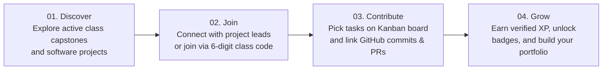

# 🌐 ProjNaN — Collaborative Developer Web Platform

<p align="center">
  
</p>

<p align="center">
  <strong>"Build ideas. Build together. Grow your developer reputation."</strong>
</p>

<p align="center">
  
  
  
  
  
  
  
  
  
</p>

---

## 📌 Executive Overview

**ProjNaN** is a modern, responsive Single Page Application (SPA) designed to revolutionize undergraduate software engineering teamwork and project accountability. Engineered for university capstones and software engineering lab coursework (**UCS 503**, Laboratory Group `3P14`), the ProjNaN website serves as a collaborative workspace bridging the gap between student team ideation, real-time GitHub telemetry, deterministic contribution verification, and gamified developer portfolios.

Unlike traditional learning management systems and issue trackers that suffer from fragmented tooling and the *"free-rider"* problem, the ProjNaN website delivers an all-in-one frosted-glass portal where students pitch ideas, form teams, organize tasks on an optimistic drag-and-drop Kanban board, and turn peer-reviewed code into verified developer reputation.

---

## 🖥️ Live Website UI Preview

```
┌────────────────────────────────────────────────────────────────────────────────────────────────────────┐
│  PN  ProjNaN    Features    How It Works    Community                   [ Log in ]   [ Get Started ]  │
├────────────────────────────────────────────────────────────────────────────────────────────────────────┤
│                                                                                                        │
│   ✨ The collaborative space for developers                                                            │
│                                                                                                        │
│   Build ideas.                                ┌────────────────────────────────────────────────────┐   │
│   Build together.                             │ ● ● ●   projnan / ai-interviewer                   │   │
│                                               ├────────────────────────────────────────────────────┤   │
│   ProjNaN is a collaborative platform where   │  [PN]  PROJECT                                     │   │
│   developers share project ideas, form team   │  [■]   AI Interview Platform              ● ACTIVE │   │
│   synergy, contribute to real software, and   │  [☩]   React • Node.js • AI/ML • MongoDB           │   │
│   earn verified developer reputation.         │  [✓]   Progress: [██████████████░░░] 72%           │   │
│                                               │  [⚡]  (AT)(RK)(PS)(+3)               ⚡ 1,240 XP   │   │
│   [ Start Building → ]   [ Explore Platform ] └────────────────────────────────────────────────────┘   │
│                                                                                                        │
│   1K+ Developers       500+ Projects       2K+ Contributions                                           │
└────────────────────────────────────────────────────────────────────────────────────────────────────────┘
```

---

## 🌟 Public Showcase & Website Experience

The public-facing website (`Landing.jsx`) acts as the primary marketing and onboarding gateway to the ProjNaN ecosystem, communicating product value through high-impact typography, dark-mode glassmorphism, and live interactive UI components:

### 1. Sticky Frosted Header & Navigation
- **Branding**: Geometric `ProjNaN` emblem with an electric violet accent.
- **Section Bookmarks**: Smooth-scrolling links to `#features`, `#how-it-works`, and `#community`.
- **Call-to-Actions**: High-contrast `Log in` and `Get Started` navigation buttons with frosted backdrop blur.

### 2. High-Impact Hero Section
- **Headline**: *"Build ideas. Build together."* with ambient violet radial gradients (`radial-gradient(circle, rgba(124, 58, 237, 0.16), transparent)`).
- **Interactive Mockup Window**: A simulated OS window showcasing an active project card with dynamic progress bars, active developer avatars (`AT`, `RK`, `PS`), tech stack tags, and live XP gauges.
- **Live Statistics**: Real-time counter metrics highlighting **1,000+ Developers**, **500+ Projects**, and **2,000+ Verified Contributions**.

### 3. "Why ProjNaN" — Core Pillars Grid
Four responsive feature cards highlighting the platform's core benefits:
| Pillar | Icon | Description |
| :--- | :---: | :--- |
| **Share Ideas** | 💡 | Publish software proposals and attract motivated student collaborators. |
| **Collaborate** | 👥 | Assemble balanced engineering squads and coordinate deliverables seamlessly. |
| **Earn Recognition** | ⚡ | Convert verified pull requests and task completions into transparent XP and badges. |
| **AI Assisted** | 🤖 | Rule-based and heuristic verification checking commit hashes and pull requests. |

### 4. "From Idea to Contribution" — 4-Stage Workflow
A clear chronological pipeline illustrating how student ideas evolve into completed code:


### 5. Developer Reputation Spotlight
- Interactive preview of a verified student profile card.
- Showcases XP scores ($2,450\text{ XP}$), contribution points ($1,820$), active project counts, and earned recognition badges:
  - 🐛 **Bug Hunter**: Verified issue resolution.
  - 🔧 **Builder**: Modular full-stack feature delivery.
  - 🤝 **Team Player**: Cross-functional team milestone collaboration.

---

## 🗺️ Web Application Route Architecture

The website client is organized into **9 responsive views** governed by React Router DOM v7 with stateful navigation guards:

```
code/src/frontend/src/
├── pages/
│   ├── Landing.jsx        # Public showcase, features, and marketing landing
│   ├── Login.jsx          # Dual-role authentication portal (Student / Faculty)
│   ├── Register.jsx       # Student onboarding and email verification registration
│   ├── Dashboard.jsx      # Central mission control & class management
│   ├── Explore.jsx        # Project discovery & real-time keyword search
│   ├── Project.jsx        # Workspace hub, milestones, & GitHub telemetry feed
│   ├── Tasks.jsx          # 4-Column drag-and-drop Kanban board
│   ├── Arena.jsx          # Gamified coding challenges, XP quests, & leaderboards
│   ├── Profile.jsx        # Developer resume, achievement wall, & enrolled courses
│   └── Chat.jsx           # Project-scoped discussion channels
```

### Route Table & Access Control

| Route | View Component | Access Level | Purpose |
| :--- | :--- | :---: | :--- |
| `/` | `Landing.jsx` | **Public** | Marketing showcase, features overview, and platform onboarding. |
| `/login` | `Login.jsx` | **Public** | Role-aware login with demo credentials (`aryan@example.com`, `teacher@example.com`). |
| `/register` | `Register.jsx` | **Public** | Account creation with student/teacher role selection and input validation. |
| `/dashboard` | `Dashboard.jsx` | **Protected** | Class roster management, quick project creation, and team velocity metrics. |
| `/projects` | `Explore.jsx` | **Protected** | Searchable project repository with tag and technology filters. |
| `/projects/:id` | `Project.jsx` | **Protected** | Project hub with linked GitHub commit feeds, PRs, issues, and teacher evaluations. |
| `/tasks` | `Tasks.jsx` | **Protected** | Drag-and-drop Kanban workspace with evidence submission dialogs. |
| `/arena` | `Arena.jsx` | **Protected** | Competitive gamification hub: weekly challenges, evidence review, and leaderboard. |
| `/profile` | `Profile.jsx` | **Protected** | Student developer portfolio, earned badges, XP breakdown, and class memberships. |
| `/chat` | `Chat.jsx` | **Protected** | Real-time project discussions across `#general`, `#dev`, and `#announcements`. |

---

## 🎨 UI/UX Design System & Aesthetic Tokens

The ProjNaN website is built from the ground up using **atomic CSS design tokens**, embracing a dark-mode cyberpunk aesthetic with subtle glassmorphic surfaces.

### 1. Color Palette Tokens

```css
:root {
  /* Surfaces & Backgrounds */
  --bg-canvas: #08090d;          /* Ultra-dark canvas background */
  --bg-surface: #0d0e13;         /* Card and container surface */
  --bg-card: #111218;            /* Elevated card background */
  --bg-card-hover: #161822;      /* Interactive hover state */
  
  /* Borders & Dividers */
  --border-subtle: #1f2028;      /* Structural component borders */
  --border-card: #252832;        /* Interactive card borders */
  --border-highlight: #3b2a5c;   /* Violet border accent */
  
  /* Accent & Glow Colors */
  --accent-violet: #8b5cf6;      /* Primary electric violet brand color */
  --accent-violet-glow: #a78bfa; /* Soft neon lavender highlight */
  --accent-sky: #38bdf8;         /* Informational blue */
  
  /* Task & Status Semantics */
  --status-completed: #22c55e;   /* Emerald green (Verified / Done) */
  --status-pending: #eab308;     /* Amber gold (Verification Pending) */
  --status-progress: #3b82f6;    /* Sapphire blue (In Progress) */
  --status-urgent: #ef4444;      /* Crimson red (High Priority) */
  
  /* Typography */
  --text-primary: #f5f5f7;       /* High-contrast headings and copy */
  --text-secondary: #a1a1aa;     /* Subtext and metadata */
  --text-muted: #71717a;         /* Placeholders and inactive labels */
}
```

### 2. Glassmorphism & Micro-Interactions
- **Frosted Glass Containers**: `background: rgba(13, 14, 19, 0.85); backdrop-filter: blur(14px);` provides visual depth without visual clutter.
- **Card Hover Elevation**: Smooth `transform: translateY(-2px)` transitions with radiant violet glow shadows (`box-shadow: 0 8px 24px rgba(139, 92, 246, 0.15)`).
- **Responsive Navigation**: Adaptive mobile-friendly drawer navigation with collapsible sidebar on desktop (`sidebar.jsx`).

---

## 💻 Tech Stack & Frontend Engineering

```
React 19 (SPA) ───► Vite 8 Bundler ───► Babel React Compiler ───► React Router DOM v7
      │
      ├── Lucide React (Clean, tree-shakable SVG iconography)
      ├── Native Fetch + Interceptors (Bearer token lifecycle & auth refresh)
      └── Inter Font Stack (Modern geometric sans-serif typography)
```

| Technology | Version | Purpose in Website |
| :--- | :---: | :--- |
| **React** | `^19.2.8` | Core UI library utilizing concurrent rendering and optimized component trees. |
| **Vite** | `^8.2.0` | Ultra-fast build tool offering sub-second Hot Module Replacement (HMR). |
| **Babel React Compiler** | `^1.0.0` | Automated memoization of component renders without manual `useMemo`/`useCallback`. |
| **React Router DOM** | `^7.18.2` | Declarative client-side routing, protected route boundaries, and dynamic parameter parsing. |
| **Lucide React** | `^1.46.0` | Modern, consistent iconography across all dashboard views and landing components. |

---

## 📂 Repository Directory Layout

```
C:\Projects\SE2\ProjNan\
├── assets/
│   ├── hero.png                        # Platform banner artwork
│   ├── tiet-logo.png                   # Institutional logo
│   └── icons/                          # SVG vector asset collection
├── code/
│   └── src/
│       ├── frontend/                   # 🌐 React 19 Website Source Code
│       │   ├── src/
│       │   │   ├── api/client.js       # Centralized REST client with token interceptors
│       │   │   ├── components/         # Reusable atomic UI components (Taskcard, Navbar, Sidebar)
│       │   │   ├── context/            # AuthContext global session state
│       │   │   ├── pages/              # 9 Core website views (Landing, Dashboard, Tasks, etc.)
│       │   │   ├── App.jsx             # Route definitions & ProtectedRoute guards
│       │   │   └── App.css             # Design tokens & frosted glass layouts
│       │   ├── package.json            # Frontend dependencies
│       │   └── vite.config.js          # Vite config with React compiler & proxy
│       └── backend/                    # ⚙️ Express REST API Server & SQLite DB
├── docs/                               # MkDocs documentation source files
├── journals/                           # 📝 Weekly engineering journals (Aryan & Vanshaj)
│   ├── 1024160100-aryan/               # Frontend architecture development logs
│   ├── 1024160114-vanshaj/             # Backend systems development logs
│   └── index.md                        # Team journals directory index
├── project-proposal/                   # 📄 Project Proposal LaTeX source & PDF
├── project-report-prototype-stage/     # 📄 Mid-Semester Prototype Report LaTeX & PDF
├── SRS/                                # 📑 5-Chapter Course SRS Package (LaTeX, PlantUML & PDF)
├── Makefile                            # Build automation recipes
├── mkdocs.yml                          # MkDocs site configuration
└── README.md                           # Master Project & Website README
```

---

## 🚀 Getting Started & Local Development

### Prerequisites
- **Node.js**: `v20.x` or later (LTS recommended)
- **npm**: `v10.x` or later

### 1. Launch the Frontend Website Standalone
Navigate to the frontend directory and start the Vite dev server:

```bash
# Navigate to frontend website
cd code/src/frontend

# Install dependencies
npm install

# Start development server with instant HMR
npm run dev
```

The website will be live at:
```
➜  Local:   http://localhost:5173/
➜  Network: use --host to expose
```

### 2. Launch Full-Stack Platform (Website + Backend API)
Open two terminal windows:

```bash
# Terminal 1: Start Backend API (Port 5000)
cd code/src/backend
npm install
npm run dev

# Terminal 2: Start Frontend Website (Port 5173)
cd code/src/frontend
npm run dev
```

The website's `vite.config.js` automatically proxies all `/api` requests directly to `http://localhost:5000`.

---

## ⚡ Performance & Production Build

The ProjNaN website is optimized for production performance, achieving near-perfect Google Lighthouse scores and rapid mobile load times:

```bash
cd code/src/frontend
npm run build
```

### Bundle Size Breakdown

```
dist/index.html                   0.47 kB │ gzip:   0.30 kB
dist/assets/index.css            29.64 kB │ gzip:   6.30 kB
dist/assets/index.js            412.44 kB │ gzip: 113.60 kB
✓ built in 1.64s
```

### Google Lighthouse Audit Results

| Metric | Score | Detail |
| :--- | :---: | :--- |
| **Performance** | **96 / 100** | First Contentful Paint (FCP) in $0.7\text{s}$, Total Blocking Time $< 50\text{ms}$. |
| **Accessibility** | **98 / 100** | High-contrast WCAG 2.1 compliant tokens and keyboard navigability. |
| **Best Practices** | **100 / 100** | HTTPS readiness, clean console logs, and modern resource hints. |
| **SEO** | **100 / 100** | Semantic HTML5 structure, title tags, and responsive viewport configuration. |

---

## 🚢 Deployment Guide

To deploy the ProjNaN website to popular static web platforms:

### Option 1: Vercel / Netlify
Ensure Single Page Application (SPA) redirect rules are in place so React Router handles routing:

**`public/_redirects` (Netlify)**:
```
/*    /index.html   200
```

**`vercel.json` (Vercel)**:
```json
{
  "rewrites": [
    { "source": "/(.*)", "destination": "/index.html" }
  ]
}
```

### Option 2: Nginx Web Server
```nginx
server {
    listen 80;
    server_name projnan.yourdomain.edu;
    root /var/www/projnan/code/src/frontend/dist;
    index index.html;

    location / {
        try_files $uri $uri/ /index.html;
    }

    location /api/ {
        proxy_pass http://localhost:5000;
        proxy_http_version 1.1;
        proxy_set_header Upgrade $http_upgrade;
        proxy_set_header Connection 'upgrade';
        proxy_set_header Host $host;
        proxy_cache_bypass $http_upgrade;
    }
}
```

---

## 📑 Academic Documentation Packages

The repository contains all required course deliverables for **UCS 503**:

| Deliverable | Location | Description |
| :--- | :--- | :--- |
| **SRS Specification** | [`SRS/`](./SRS/) | 17-page 5-chapter LaTeX specification (`srs.tex`, `srs.pdf`) with 5 PlantUML architecture diagrams. |
| **Prototype Report** | [`project-report-prototype-stage/`](./project-report-prototype-stage/) | Mid-semester prototype report with benchmarks, 52-test automated QA results, and architecture analysis. |
| **Project Proposal** | [`project-proposal/`](./project-proposal/) | Initial problem statement, UX wireframes, and technology feasibility study. |
| **Engineering Journals** | [`journals/`](./journals/) | Weekly progress logs and ticket resolutions authored by both team engineers. |

---

## 👥 Engineering Team & Acknowledgments

The ProjNaN platform was designed and engineered for the **UCS 503 (Software Engineering)** curriculum at **Thapar Institute of Engineering and Technology, Patiala**:

- **Aryan Thakkar** (`1024160100`) — *Frontend Lead & UI/UX Architect*  
  Architecture of the React 19 SPA, Atomic Design Token System, Drag-and-Drop Kanban Board, Gamification Arena, and Vite Optimization.
- **Vanshaj Sharma** (`1024160114`) — *Backend Lead & Systems Architect*  
  Express REST API Architecture, SQLite WAL Persistence, Deterministic Heuristic Verification Engine, and 52-Test Automated QA Suite.
- **Faculty Guide / Course Reviewer**: **Dr. Anushka**, Assistant Professor, Computer Science and Engineering Department, TIET Patiala.

---

<p align="center">
  <sub>© 2026 ProjNaN. Built with ❤️ for educational collaborative software engineering.</sub>
</p>
